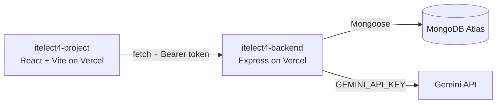

# ITELECT4 Project - Peer Tutoring Platform

[](https://github.com/jeclique444/itelect4-project/actions/workflows/ci.yml)

A modern, responsive web application where students can book tutoring sessions from peer tutors. Tutors create sessions, students book them, and both parties can track progress through a complete booking lifecycle. The platform also features a built-in AI assistant to review and improve session plans before publishing.

## 🔗 Live URLs

*   **Live Frontend App:** [https://itelect4-project-two.vercel.app](https://itelect4-project-two.vercel.app)
*   **Live Backend API:** [https://itelect4-backend-neon.vercel.app](https://itelect4-backend-neon.vercel.app)
*   **Backend Repository:** [https://github.com/jeclique444/itelect4-backend](https://github.com/jeclique444/itelect4-backend)

## Architecture



## Key Features

- **Authentication:** Secure login and registration flow using JWT stored in a global state.
- **Dashboard:** View and interact with user profiles via animated, 3D-tilting cards.
- **Session Management:** Create and view tutoring sessions.
- **AI Review Page:** A dedicated page where users can describe a session plan and receive structured feedback (Summary, Strengths, Improvements, Readiness) generated by Gemini AI.
- **Dark Mode:** Full dark mode support across the entire application.
- **Form Validation:** Robust client-side validation using Zod and React Hook Form.

## Tech Stack

*   **Framework:** React 18, Vite, TypeScript
*   **Styling:** Tailwind CSS
*   **State Management:** Zustand (auth & UI)
*   **Data Fetching:** TanStack Query (React Query)
*   **Forms & Validation:** React Hook Form, Zod
*   **Routing:** React Router v6
*   **Testing & CI:** Vitest, React Testing Library, GitHub Actions

## Local Setup

### Prerequisites
- Node.js (v22 or higher)
- npm (v10 or higher)

### Steps

1.  **Clone the repository:**
    ```bash
    git clone https://github.com/jeclique444/itelect4-project.git
    cd itelect4-project
    ```

2.  **Install dependencies:**
    ```bash
    npm install
    ```

3.  **Environment Variables:**
    Create a `.env` file in the root directory and add the backend URL:
    ```env
    VITE_API_URL=http://localhost:4000
    ```

4.  **Run the application:**
    ```bash
    npm run dev
    ```
    The app will run on `http://localhost:5173`.

## Testing

This project uses **Vitest** and **React Testing Library** for component, hook, and form testing.

```bash
# Run the test suite
npm test

# Run linter
npm run lint

# Build for production (TypeScript check)
npm run build
```

*Note: The CI workflow in `.github/workflows/ci.yml` runs tests, linting, and builds on every push.*

## List of Interfaces/Types Defined

### User
```typescript
interface User {
  id: string | number;       // Unique identifier
  name: string;              // Full name
  email: string;             // Email address
  role: "tutor" | "tutee" | "admin";  // User role
  isActive: boolean;         // Account status
  rating?: number;           // Optional tutor rating
  subjects?: string[];       // Optional subjects they can teach
}
```

### Session
```typescript
interface Session {
  id: number;                // Unique identifier
  tutorId: number;           // Reference to User (tutor)
  subject: string;           // Subject being taught
  description: string;       // Session details
  duration: number;          // Duration in minutes
  capacity: number;          // Max number of students
  schedule: Date;            // When the session happens
  price: number;             // Cost per session
  location: string;          // Where it happens
  status: "active" | "cancelled" | "full";  // Session status
}
```

### Booking
```typescript
interface Booking {
  id: number;                // Unique identifier
  sessionId: number;         // Reference to Session
  tuteeId: number;           // Reference to User (tutee)
  status: "requested" | "confirmed" | "waitlisted" | "completed" | "cancelled";
  bookedAt: Date;            // When booking was made
  attendedAt?: Date;         // When they attended
  feedback?: string;         // Feedback after session
  rating?: number;           // Rating given
}
```

### Type Aliases
```typescript
type ID = number;                              // Unique identifier type
type StringOrNumber = string | number;         // Flexible type
type Status = "pending" | "active" | "inactive"; // Generic status
type BookingStatus = "requested" | "confirmed" | "waitlisted" | "completed" | "cancelled";
```

### Utility Types
```typescript
type UserUpdate = Partial<User>;  // All fields optional for updates
type UserPreview = Pick<User, "id" | "name" | "role" | "rating">;  // Selected fields
type PublicUser = Omit<User, "email" | "isActive" | "subjects">;  // Excludes sensitive fields
type RoleCount = Record<"tutor" | "tutee" | "admin", number>;  // Dashboard statistics
```

### Generic Interface
```typescript
interface ApiResponse<T> {
  success: boolean;
  data: T;                          // T is a placeholder that works with any data type
  message?: string;
  timestamp?: Date;
}
```

### Generic Functions
```typescript
function getFirst<T>(items: T[]): T | undefined
function getById<T extends { id: number }>(items: T[], id: number): T | undefined
function getItemsByStatus<T extends { status: string }>(items: T[], status: string): T[]
function createApiResponse<T>(data: T, success?: boolean, message?: string): ApiResponse<T>
```

### Enums
```typescript
// Regular enum - supports reverse mapping
enum BookingStatusEnum {
  Requested = "requested",
  Confirmed = "confirmed",
  Waitlisted = "waitlisted",
  Completed = "completed",
  Cancelled = "cancelled"
}

// Const enum - inlined at compile time
const enum UserRole {
  Tutor = "tutor",
  Tutee = "tutee",
  Admin = "admin"
}

// Numeric enum - auto-incrementing values
enum SessionStatus {
  Active,      // 0
  Cancelled,   // 1
  Full         // 2
}
```

## AI-Use Disclosure

The UI, state management, and API client were built by the student. AI tools (like Gemini/ChatGPT) were used for generating boilerplate code, debugging test suites, and assisting with Tailwind CSS styling classes. The Gemini API is used in production to power the AI Review feature.

## Author

**Jeric Lique** - ITELECT4 Student